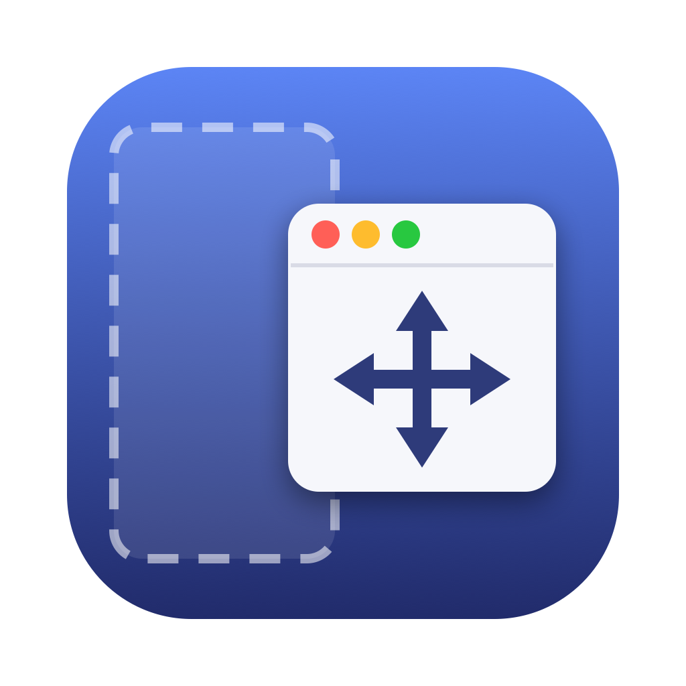
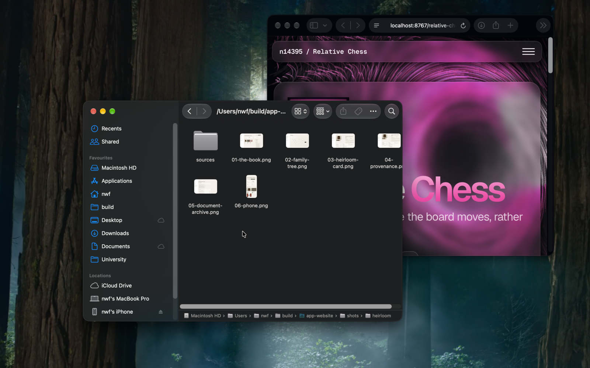
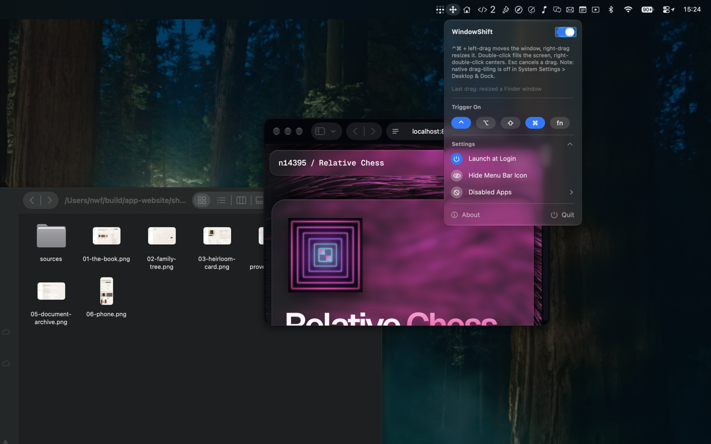

<p align="center">
  
</p>

<h1 align="center">WindowShift</h1>

**Move and resize any macOS window from anywhere on it — with native tiling intact.**

Hold ⌃⌘ and drag anywhere in a window to move it, or right-drag to resize —
alt-drag, the way Linux desktops have always done it. Most utilities reposition
windows through the Accessibility API, which macOS doesn't recognize as a drag.
WindowShift asks the window server for a genuine drag session instead, so
everything that hooks into real drags still works.

<!-- TODO: demo GIF — drag from window body → native tile preview → Esc cancel -->



## Features

- **Snap apps just work** — verified against Magnet; the mechanism is generic,
  so Rectangle, BetterTouchTool and Loop should behave the same way
- **Native tiling too**, on the same drag — keep holding ⌥ as you let go and
  macOS tiles the window instead of your snapper (see [Choosing which one
  tiles](#choosing-which-one-tiles))
- **Any window** — even ones whose title bar is crowded with tabs and controls,
  or parked off-screen entirely
- **Native drag speed** — no per-frame IPC, and the cursor never warps
- **Esc to cancel** mid-drag, undoing a snap that already committed
- Optional magnetic window-to-window snapping
- Menu bar app, hideable, no configuration required

## Requirements

macOS 13 or later. Native edge-drag tiling is itself a macOS 15 (Sequoia)
feature; on older systems moving, resizing and third-party snap apps all still
work.

## Install

Download the latest `.dmg` from [Releases](../../releases), drag WindowShift to
Applications, and launch it.

It asks for two permissions on first run, both under **System Settings →
Privacy & Security**:

| Permission | Why |
|---|---|
| **Accessibility** | Required. Watches and rewrites the mouse events that make up the gesture. |
| **Screen Recording** | Nothing is ever captured or recorded. This is the grant macOS checks before one app may drive another app's windows, which is what the window-server drag call does. Without it windows still move, but through plain Accessibility repositioning — no native tiling, no Magnet or Rectangle. |

## Usage

Default trigger: **⌃⌘**. Change it from the menu bar icon under *Trigger On*.

| Gesture | Action |
|---|---|
| trigger + left-drag | Move the window |
| trigger + right-drag | Resize from the corner nearest your click |
| trigger + double-left-click | Fill the screen's visible frame; again to restore |
| trigger + double-right-click | Center the window, size unchanged |
| **Esc** during a drag | Cancel — the window returns to its original frame |
| extra modifier + click | Pass the click through to the app untouched |

Double-click speed follows your system setting. A trigger-click without a drag
is swallowed, so the app underneath never sees it — which is why the
click-only actions are double-clicks.

### Choosing which one tiles

If you run a snapping app, its zones and macOS's own tiling both want the same
drop, so the modifiers you are still holding when you release the button pick
between them:

| At the moment you let go | What tiles the window |
|---|---|
| the trigger combo, or nothing | your snapping app — Magnet, Rectangle, … |
| **⌥ alone** (let the rest of the combo go first) | **macOS tiling** |

Native tiling needs **Desktop & Dock → "Hold ⌥ key while dragging a window to
tile"** switched on. With it off, ⌥ does nothing and every drop goes to your
snapper. The two "drag windows to screen edges to tile" switches are
independent; leaving them off keeps plain edge drops for your snapper and makes
⌥ the deliberate way to ask for a macOS tile.

With no snapping app installed there is nothing to choose between, but a plain
drop still just *moves* the window — ⌥ is what tiles it. Switch on "drag
windows to screen edges to tile" as well if you want plain edge drops to tile
on their own.

> **A trigger combo containing `opt` is fine** — WindowShift scrubs the combo
> off the events it emits, so holding it does not trip macOS's ⌥ tiling. That
> is what makes "release everything but ⌥" a distinct instruction rather than
> an accident. The menu still warns about combos that clash with a system
> gesture.

## Configuration

The menu bar icon covers the everyday things: master on/off, trigger combo,
launch at login, hiding the icon, and per-app exclusions. It also shows a
**Last drag:** line explaining what the most recent gesture did, or why it was
ignored.



Everything is a key in the `dev.nwf.WindowShift` defaults domain. The app
observes the domain, so `defaults write` changes apply instantly — no relaunch.

| Key | Default | Meaning |
|---|---|---|
| `enabled` | `true` | Master on/off — the toggle at the top of the menu |
| `modifiers` | `ctrl,cmd` | Trigger combo; any of `cmd`, `ctrl`, `opt`, `shift`, `fn` |
| `magneticSnapDistance` | `0` | Window-to-window snap distance in px; `0` is off |
| `resizeInset` | `8` | Resize grab inset from the corner, px — raise it for large rounded corners |
| `disabledApps` | `()` | Bundle IDs WindowShift ignores |
| `showMenuBarIcon` | `true` | Menu bar icon visibility |

```sh
defaults write dev.nwf.WindowShift modifiers -string "ctrl,opt,cmd"
defaults write dev.nwf.WindowShift magneticSnapDistance -float 8
defaults write dev.nwf.WindowShift disabledApps -array "com.apple.finder"
```

`magneticSnapDistance` and `resizeInset` have no menu equivalent yet — set them
here. Magnetic snapping only considers windows adjacent on the other axis,
never applies to resize drags, and snapshots neighbor positions when the drag
starts.

**Hiding the menu bar icon:** use Settings → Hide Menu Bar Icon, or ⌘-drag the
icon off the bar. WindowShift keeps running headless. To bring it back, launch
WindowShift again from Spotlight or Finder, or set `showMenuBarIcon` back to
`true`.

## How it works

A session-level `CGEventTap` watches the mouse. On trigger + mouseDown it
swallows the click, finds the window under the cursor via the Accessibility
API, raises it, and places a tiny invisible panel under the cursor. The next
drag event is rewritten into a `leftMouseDown` on that panel, so a mouse button
is genuinely held without the app underneath ever seeing a click. As soon as
that press has actually landed, the live button is handed to the window
server's `SLSDragWindowRelativeToMouse`, which begins a real drag of the target
window — named by ID, so it needn't be clickable, on-screen, or free of
controls. From there the window tracks the mouse 1:1 until release, and
everything downstream (native tiling, Mission Control drops, Spaces
edge-switching, Magnet, Rectangle) behaves exactly as it does for a manual
title-bar drag. Magnetic snapping is expressed as an adjustment to the event
locations, because the drag follows the event stream rather than the hardware
cursor.

Two details of that are load-bearing, and both look like tidying opportunities:

**The tap is tail-appended, not head-inserted.** Snapping apps identify the
window you are dragging by hit-testing Accessibility at the mouse-down. Going
last in the tap chain means they see your real press, at the point you actually
grabbed, before WindowShift has put anything under the cursor — so it resolves
to your window — and only afterwards do we swallow that press so the app itself
never receives it. Head-inserting the tap silently kills third-party snapping:
the only press those apps would then see is the synthetic one, which resolves to
a WindowShift panel. (The synthetic press is a rewritten *drag* event, which
snappers don't watch, so it can't override the attribution they already made.)

**The panel is placed at the mouse-down, not at the drag that clicks it.** The
window server applies geometry on its own schedule, so a panel moved and clicked
in the same instant can still be hit-tested at its previous position — and the
click lands in the user's document instead, selecting text or dragging Finder
items. Placing it one event earlier is what buys the server time to apply it.
The panel is also resident — parked a single pixel on-screen between gestures
rather than ordered in and out — because making a window visible costs a
CoreAnimation fence round-trip to the window server, and the server is busiest
during exactly a drag, a tile preview or a snap. Sampling caught that call
blocking the main thread for over a second, which lost whole gestures.

Which engine gets a given drop is a separate question, decided by the modifiers
on the events at the *release*: the trigger combo is scrubbed off, leaving a
clean release that your snapper acts on, while ⌥ held without the rest of the
combo is passed through, which is what macOS's ⌥ tiling reads.

Resize works the older way: the first right-drag is rewritten into a
`leftMouseDown` on the window's resize border at the nearest reachable corner,
starting a native resize session. There is no window-server primitive for
interactive resize, and resize needs no tiling interop.

`SLSDragWindowRelativeToMouse` is private API, resolved at runtime rather than
linked. If a future macOS removes it — or the Screen Recording grant is missing,
in which case the call reports success and moves nothing — WindowShift detects
it empirically, falls back to plain Accessibility moves, and says so in the
menu.

## Building from source

Requires full Xcode: SwiftPM needs its toolchain for the SwiftUI macro plugins.

```sh
./build.sh                 # build build/WindowShift.app
./build.sh --dmg           # ...and package it into build/WindowShift.dmg
./build.sh --sign          # ...Developer ID sign, notarize and staple
./build.sh --publish v1.2  # tag, push and cut a GitHub release from the .dmg
```

Flags combine. Then `open build/WindowShift.app`.

Local builds sign with your Apple Development certificate when one is in the
keychain (`CODESIGN_IDENTITY` overrides the choice), and fall back to an ad-hoc
signature otherwise. Either way the signature is stable across rebuilds, so
macOS keeps the Accessibility grant instead of re-prompting.

WindowShift cannot be sandboxed — it needs event taps, Accessibility, and a
private framework — so it can never ship through the Mac App Store.

## Credits

Event-rewriting technique studied from
[AnyDrag](https://github.com/XueshiQiao/AnyDrag) (GPL-3; mechanism studied, no
code copied), with detection-side validation against
[Rectangle](https://github.com/rxhanson/Rectangle) and the
WindowManager.framework tiling internals. The window-server drag call was found
by probing SkyLight directly, and the interop with snapping apps was worked out
by reading Magnet's imported symbols and event-tap mask to see how it decides
which window a drag belongs to.

## License

Licensed under the [Apache License, Version 2.0](LICENSE).
Third-party attribution is in [NOTICE](NOTICE).
